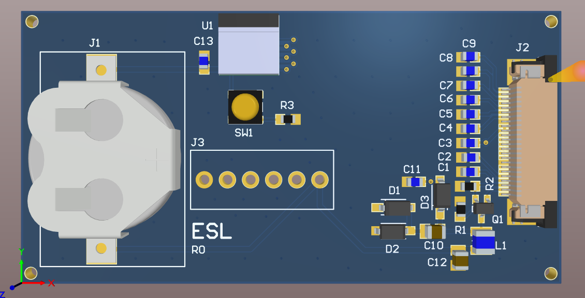
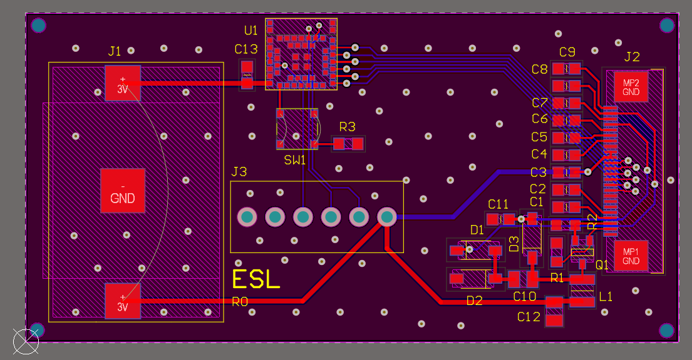

# Digital Price Tag (ANNA-B112 + E-Ink)

Electronic shelf label (`ESL`, R0) built around the u-blox ANNA-B112
Bluetooth LE module (nRF52832). It drives a 24-pin SPI e-paper panel through
the usual on-board boost circuit and runs straight from a coin cell. Prices are
pushed over BLE from a phone or a gateway.

| 3D view | 2D layout |
| --- | --- |
| [](images/pcb-3d-view.png) | [](images/pcb-layout-2d.png) |

## On the board

| Ref | Part | Role |
| --- | --- | --- |
| U1 | ANNA-B112-01B | BLE module (nRF52832) |
| J2 | Würth 68712414022, 24-pin 0.5 mm FPC | E-paper panel connector (`SCLK`, `SDI`, `CS`, `D/C`, `RES`, `BUSY`) |
| L1, Q1, D1–D3, R2 | 10 µH + SI1308EDL + MBR0530 ×3 + 0.47 Ω | E-paper gate-voltage boost (`GDR`, `RESE`, `PREVGH`, `PREVGL`) |
| J1 | Keystone 3092 coin cell holder | Battery (BOM: CR1632), feeds the `3V` rail directly |
| J3 | TE 282834-6, 6-way 2.54 mm terminal block | Programming / I/O (the sheet carries `SWDIO`, `SWDCLK`, `RESET_N`, `GPIO_14`) |
| SW1 | TL3312NF160Q | Push button |

The BOM also lists the e-paper panel itself (MPN 4243) and the CR1632 cell as
non-placed items.

> The previous README called for a CR2032 cell, a 3.3 V LDO and a level
> shifter. The schematic has no regulator or level shifter: the module and the
> panel run from the coin cell, and the holder (Keystone 3092) and BOM are for a
> CR1632.

## Firmware

`firmware/` holds a skeleton nRF5 SDK 17.1 project (`nrf52832_xxaa`, S132
SoftDevice). It defines a price-tag GATT service `0x180C` with a 32-byte price
string characteristic `0x2A56` and a refresh trigger `0x2A57`. The e-ink SPI
driver is still a placeholder. `firmware/gateway/ble_gateway.py` is a small
Python BLE client for pushing prices.

## Repository layout

```
0009_digital_price_tag/
├── PCB/                                       # Altium Designer project
│   ├── ESL_PCB_Project.PrjPCB                 # Project file (open this)
│   ├── ESL.SchDoc                             # Schematic
│   ├── ESL.PcbDoc                             # PCB layout
│   ├── ESL.PCBDwf                             # Draftsman drawing
│   ├── OutJob.OutJob                          # Output job
│   └── Project Outputs for ESL_PCB_Project/   # BOM, Gerbers, STEP and PDFs
├── firmware/                                  # nRF5 SDK firmware skeleton + BLE gateway script
└── images/                                    # Renders used in this README
```

## Component library

This repo stores no libraries. Every part comes from the general Altium library
in [Gueni/0000_libraries](https://github.com/Gueni/0000_libraries):

| File | Used for |
| --- | --- |
| [`Altium/DATABASE.DbLib`](https://github.com/Gueni/0000_libraries/blob/master/Altium/DATABASE.DbLib) | Database library the schematic components link to |
| [`Altium/DB.mdb`](https://github.com/Gueni/0000_libraries/blob/master/Altium/DB.mdb) | Parts database (part numbers, MPNs, suppliers) |
| [`Altium/SCH.SchLib`](https://github.com/Gueni/0000_libraries/blob/master/Altium/SCH.SchLib) | Schematic symbols |
| [`Altium/FTP.PcbLib`](https://github.com/Gueni/0000_libraries/blob/master/Altium/FTP.PcbLib) | PCB footprints and 3D models |

### Setup

The project finds the library through a relative path, so clone both repos side
by side in the same workspace folder:

```
WORKSPACE/
├── 0000_libraries/                   # git clone https://github.com/Gueni/0000_libraries.git
└── 0009_digital_price_tag/           # this repo
```

The project file references `..\..\0000_libraries\Altium\DATABASE.DbLib` and
adds `..\..\0000_libraries\Altium\` as a library search path. The DbLib's
database path is absolute (`D:\WORKSPACE\0000_libraries\Altium\DB.mdb`); see the
[library README](https://github.com/Gueni/0000_libraries#setup) if your
workspace lives elsewhere.
